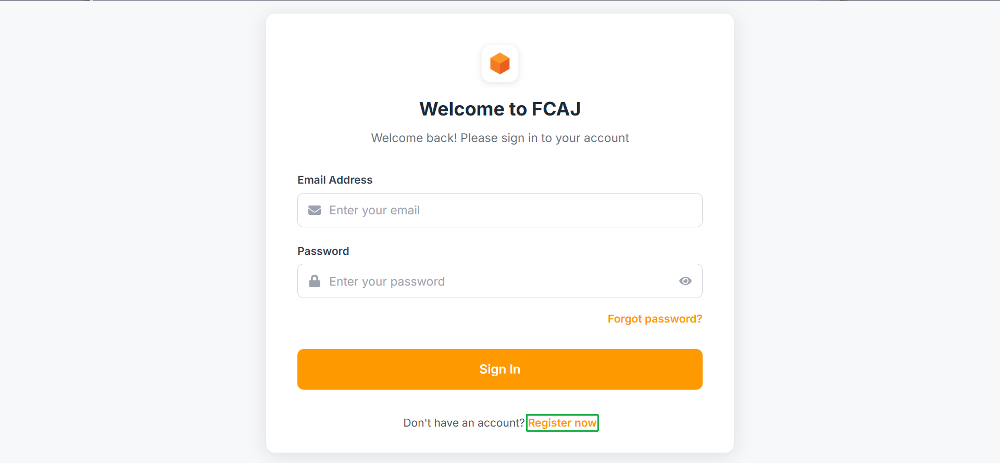
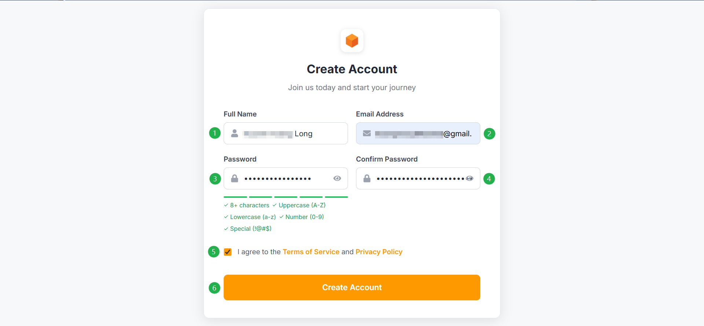
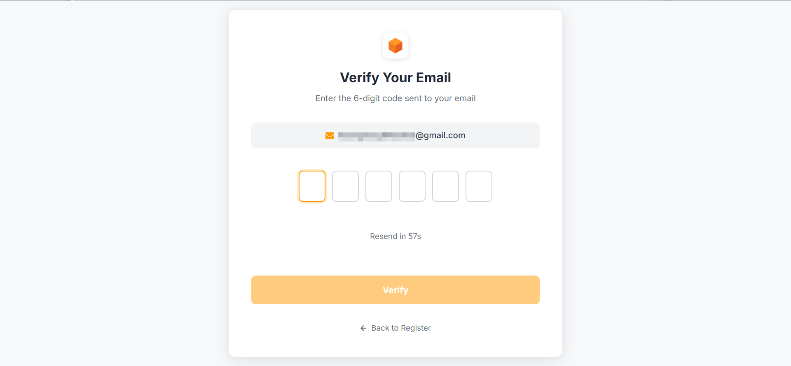
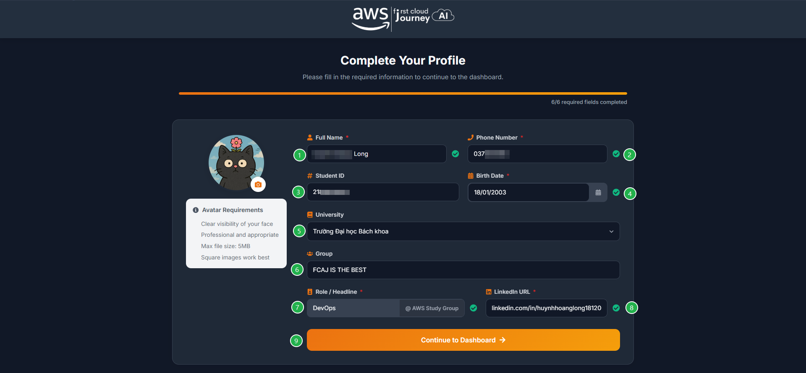
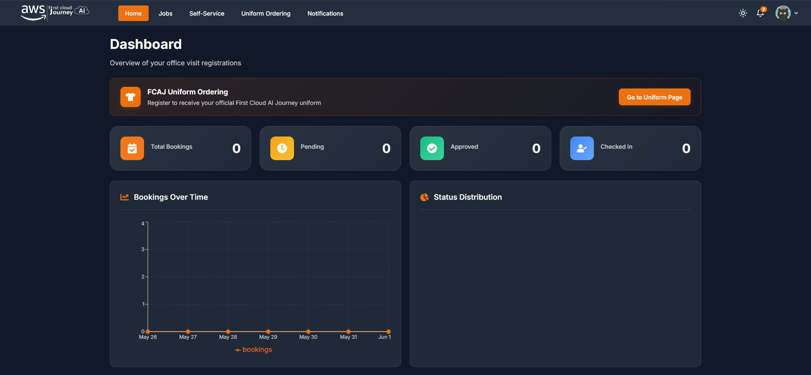
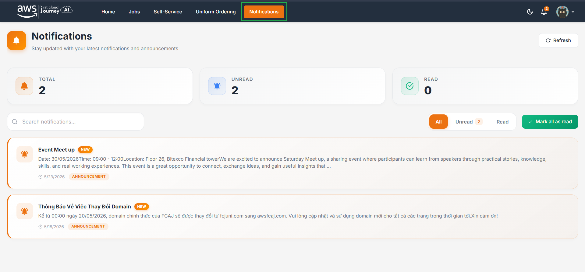

## Trước khi lên văn phòng

Sinh viên đăng ký account trước khi lên văn phòng. Account phục vụ việc đăng ký lên văn phòng, nộp workshop, tham gia sự kiện.

## Cách thức đăng ký

<Steps>
  <Step title="Truy cập Portal">
    Truy cập trang [HCM-Portal](https://hcm-portal.awsfcaj.com/). Giao diện trang sẽ giống như hình sau:

    Nếu chưa có tài khoản, bấm **Register now**.

    

    :::warning
    Chỉ sử dụng **1 email duy nhất** trong suốt quá trình học tập tại FCAJ.
    :::
  </Step>
  <Step title="Tạo tài khoản">
    Nhập các thông tin và bấm **Create account**.

    
  </Step>
  <Step title="Xác thực OTP">
    Xác thực mã OTP được gửi về email.

    
  </Step>
  <Step title="Cập nhật thông tin cá nhân">
    Sau khi xác thực xong, bạn sẽ được chuyển đến trang thông tin cá nhân. Tại đây hãy cập nhật đầy đủ và chính xác các thông tin cá nhân.

    :::warning
    - Điền đầy đủ họ tên, viết hoa chữ cái đầu, có dấu.
    - Điền đúng tên group, không trùng với tên group khác.
    - Cập nhật avatar rõ mặt bản thân.
    - Mọi vấn đề phát sinh do sai thông tin cá nhân, team sẽ không giải quyết.
    :::

    
  </Step>
  <Step title="Vào trang chủ">
    Sau khi hoàn tất, chúng ta sẽ đến với giao diện trang chủ.

    
  </Step>
</Steps>

## Trang thông báo

Tại trang **Notifications** sẽ hiển thị các thông báo. Các bạn thường xuyên vào trang này để được cập nhật đầy đủ các thông tin.

