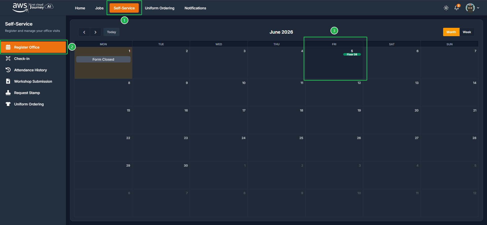
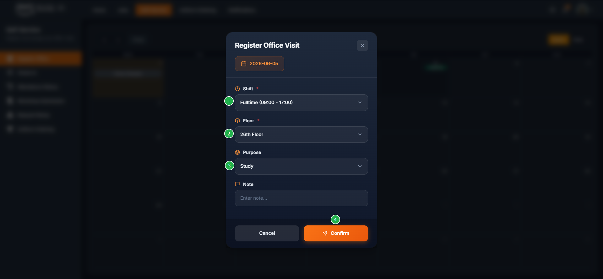
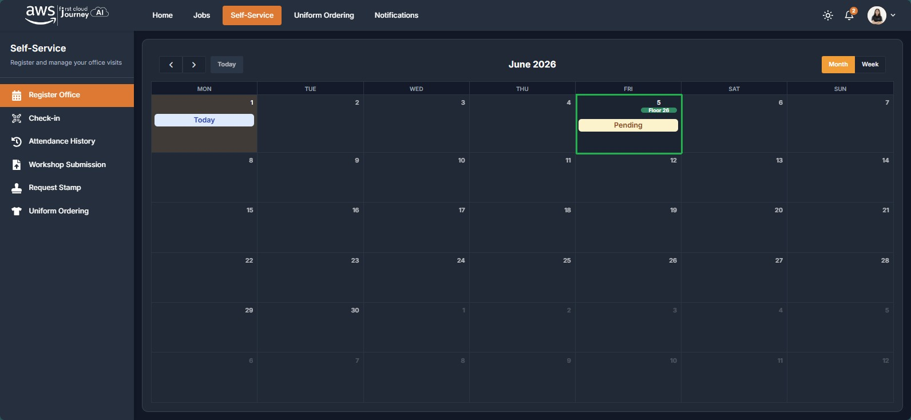
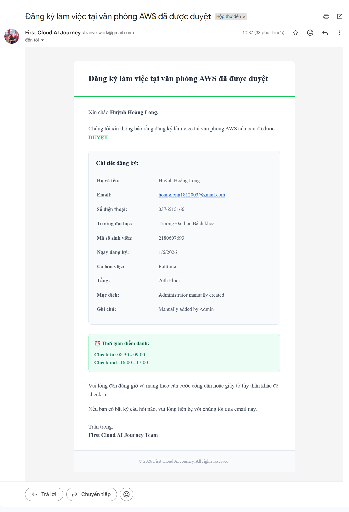

Sinh viên đăng ký lịch lên văn phòng trên portal **trước 17:00** của ngày hôm trước. Quy định hủy đăng ký xem tại [Chuyên cần & Điểm danh](/regulations/diligence#huy-dang-ky).

## Các bước đăng ký

<Steps>
  <Step title="Mở trang đăng ký">
    Truy cập **Self-Service**, chọn **Register office**. Tại đây sẽ hiển thị các ngày được mở để đăng ký. Chọn ngày bạn muốn đăng ký.

    
  </Step>
  <Step title="Nhập thông tin và xác nhận">
    Nhập các thông tin cần thiết. Ngày thường chọn **Study**, ngày event chọn **Event**. Bấm **Confirm** để xác nhận đăng ký.

    
  </Step>
  <Step title="Chờ duyệt">
    Sau khi hoàn tất đăng ký, lịch sẽ hiển thị trạng thái **Pending**. Sau 17h sẽ có 2 trường hợp xảy ra (xem bên dưới).
  </Step>
</Steps>

## Kết quả duyệt lịch

### Trường hợp 1: vẫn Pending, không được duyệt

Sau 17h của 1 ngày trước khi lên văn phòng, nếu vẫn còn trạng thái **Pending**, nghĩa là bạn **không được duyệt** lên văn phòng.

### Trường hợp 2: Approved, được duyệt

Sau 17h nếu trạng thái thành **Approved**, nghĩa là bạn đã được duyệt lên văn phòng.

:::note
Sau khi đã được duyệt lên văn phòng, kiểm tra email để xác nhận thông tin.

Trường hợp trạng thái **Approved** nhưng không có mail, vẫn lên văn phòng như trạng thái portal. Ưu tiên tuân thủ theo trạng thái trên portal.
:::

:::warning[Nhớ hủy lịch nếu không đi được]
Đã đăng ký mà không lên, sinh viên bị tính là vắng. Phải hủy trước ít nhất 01 ngày. Xem [Chuyên cần & Điểm danh](/regulations/diligence#huy-dang-ky).
:::
