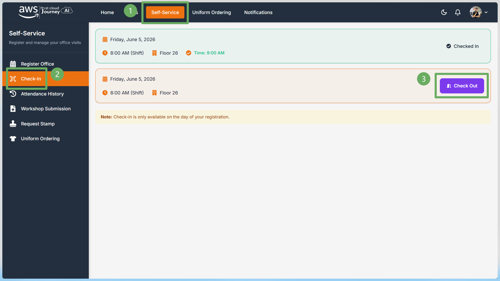
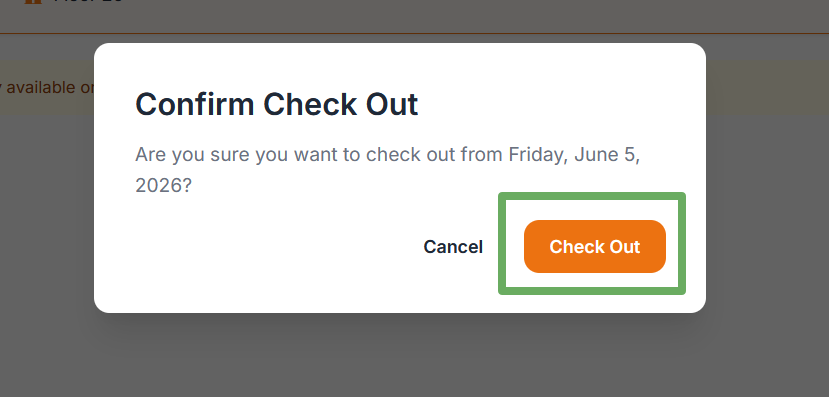
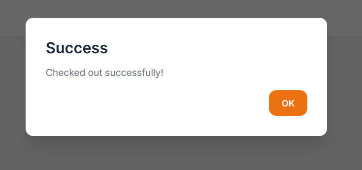

Sau khi đã check-in tại văn phòng, các bạn cần thực hiện check-out trên trang Self-Service để hoàn tất điểm danh trong ngày.

## Cách thức check-out

- Truy cập **Self-Service** trên portal.
- Chọn mục **Check-in** ở thanh menu bên trái.
- Tại danh sách lịch đăng ký trong ngày, tìm dòng đã **Checked In** và bấm **Check Out**.

- Một hộp thoại xác nhận sẽ hiển thị. Kiểm tra lại ngày cần check-out, sau đó bấm **Check Out** để xác nhận.

- Khi thao tác thành công, hệ thống sẽ hiển thị thông báo **Success**.

## Lưu ý

- Chỉ thực hiện check-out sau khi đã check-in đúng ngày đăng ký.
- Sau khi hoàn tất, các bạn có thể kiểm tra lại trạng thái trong **Attendance History**.
- Checkout sau 17h sẽ được xem là vắng mặt.
- Khi checkout không thành công, vui lòng liên hệ ngay với các anh chị admin.
