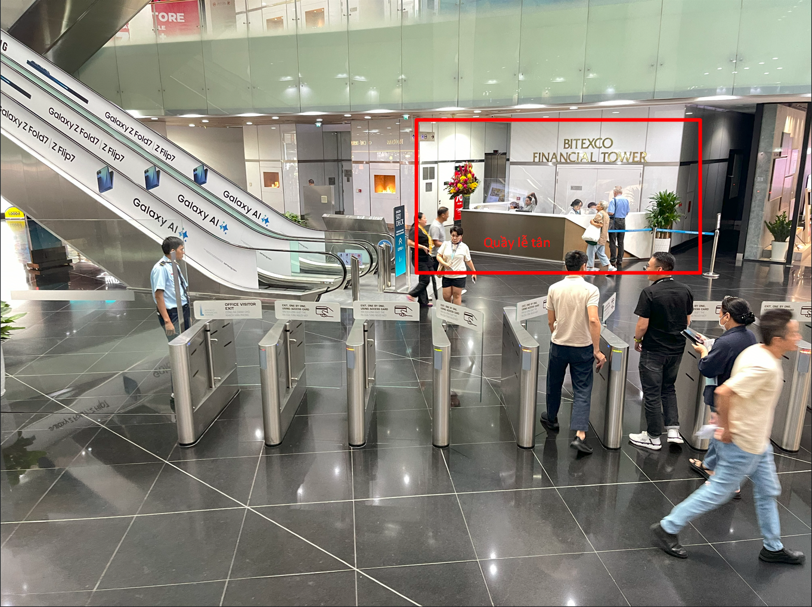
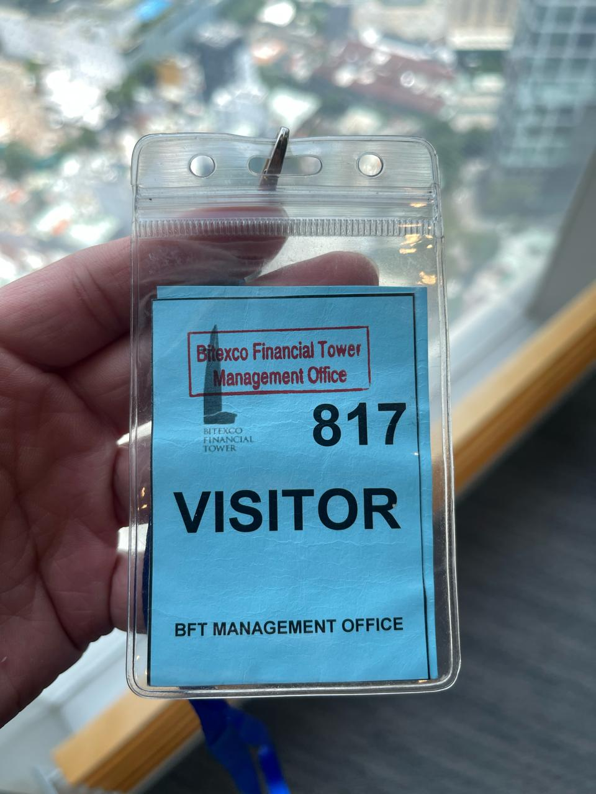
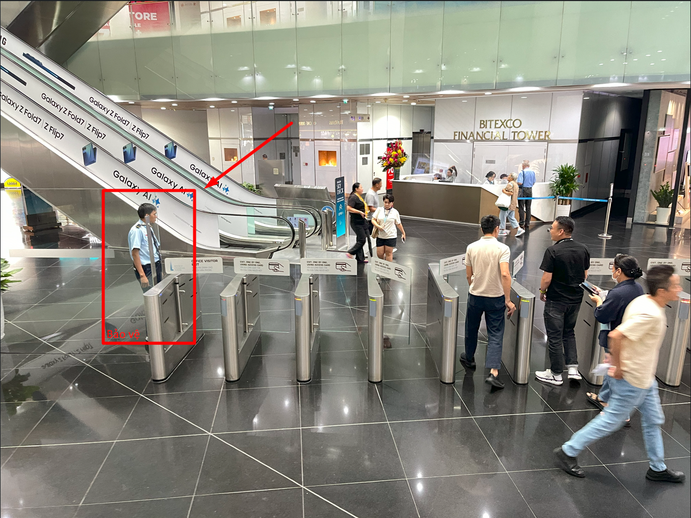
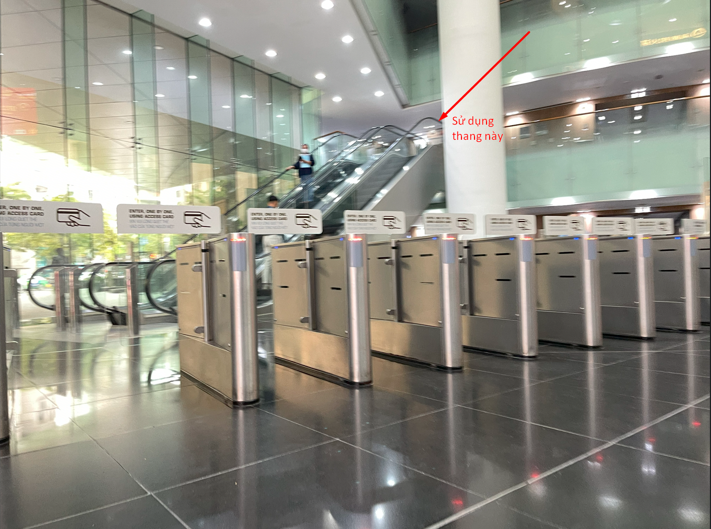
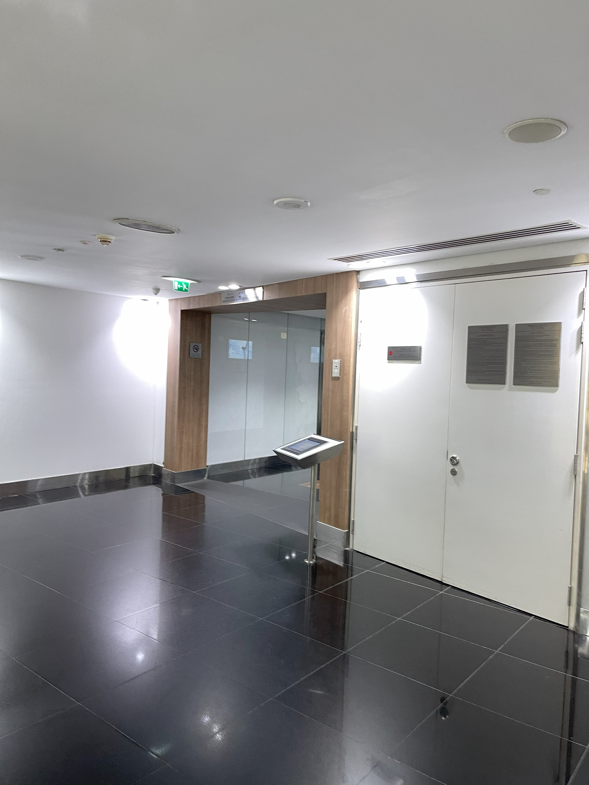
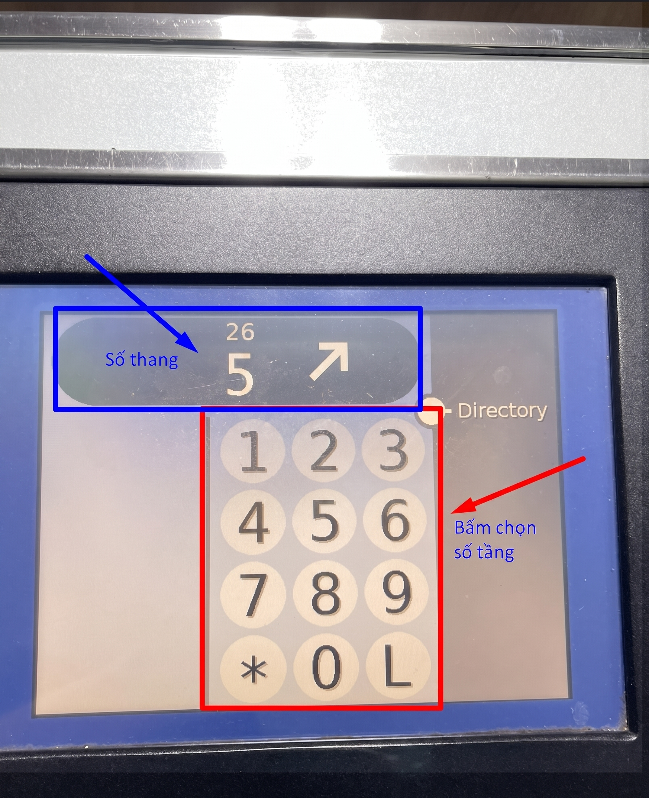

Dưới đây là toàn bộ hướng dẫn chi tiết để giúp các bạn nào chưa từng đến văn phòng AWS có thể di chuyển một cách thuận tiện nhất có thể.

:::danger[Không đến văn phòng trước 08:30]
Sinh viên **không được** đến văn phòng trước 08:30. Sinh viên đến sớm phải **đợi ở dưới tòa nhà Bitexco** đến đúng 08:30 mới được lên. Khung đến văn phòng và check-in với bảo vệ: **08:30 – 09:00**. Xem [Quy định về thời gian](/regulations/time).
:::

## Chuẩn bị

Trước khi lên văn phòng cần chuẩn bị những thứ sau:

- Giấy tờ tùy thân: Thẻ căn cước công dân/bằng lái xe/thẻ sinh viên.
- Máy tính laptop cá nhân.
- Nước uống.

## Quy trình lên văn phòng

<Steps>
  <Step title="Vào sảnh Bitexco">
    Khi di chuyển đến tòa nhà Bitexco, các bạn đi đến quầy lễ tân tại sảnh, **đọc họ tên của các bạn** để được bảo vệ mở cửa vào.

    

    Trường hợp các bạn đến vì **lý do khác**, vui lòng **mượn thẻ** visitor để được vào cổng. Để mượn thẻ visitor, các bạn phải có giấy tờ tùy thân (CCCD / bằng lái).

    Thẻ visitor như hình dưới:

    
  </Step>
  <Step title="Qua cổng an ninh">
    Sau khi nhận được thẻ (nếu có), các bạn vui lòng đeo lên và đi về hướng bảo vệ đang đứng tại cổng ra vào (trước thang cuốn, đối diện quầy lễ tân tại sảnh). Bảo vệ tòa nhà sẽ quẹt thẻ và mở cửa cho bạn.

    
  </Step>
  <Step title="Đi thang cuốn lên tầng 1">
    Sau khi đi qua cổng, các bạn vui lòng di chuyển lên tầng 1 thông qua **thang cuốn**.

    
  </Step>
  <Step title="Rẽ trái đến khu thang máy">
    Sau khi đi thang cuốn lên tầng 1, ta sẽ rẽ trái để lên **tầng 26**.

    
  </Step>
  <Step title="Gọi thang máy">
    Trước mỗi khu vực thang đều có màn hình để bấm số thang máy. Các bạn bấm số thang sau đó đợi khoảng 1s để màn hình hiển thị **số thang máy** để di chuyển cho đúng.

    
  </Step>
  <Step title="Check-in với bảo vệ tại tầng 26">
    Khi đã di chuyển lên tầng 26, vui lòng đi qua cửa chính và check-in với bảo vệ trực (đọc tên của mình để bảo vệ check tên trong danh sách).

    :::warning
    Tại tầng 26, đảm bảo check-in với bảo vệ. Nếu không thấy bảo vệ, vui lòng đợi.

    Sau khi **check-in xong**, các bạn **đi thẳng vào phòng Amazon Q**. Nếu không rõ có thể hỏi bảo vệ.
    :::
  </Step>
  <Step title="Vào phòng và ngồi học">
    Sau khi vào được phòng, vui lòng tìm một vị trí ghế trống để ngồi và sử dụng laptop để học tập và làm việc.

    :::note
    Vì các phòng này cần được mở khóa bởi lễ tân, nếu các bạn đến trước lễ tân, có thể sẽ không vào được phòng. Trong trường hợp này, vui lòng chờ cho đến khi gặp được các anh chị lễ tân và nhờ họ mở.
    :::
  </Step>
</Steps>

## Wifi tại văn phòng AWS

| Khu vực | SSID       | Mật khẩu       |
| ------- | ---------- | -------------- |
| Tầng 26 | Event Hall | `q1w2e3r4t5y6` |

## Hỗ trợ

<Callout type="info" title="Cần nhớ" icon="lightbulb" color="#DA70D6">
  Các bạn có thể nhờ sự hỗ trợ của lễ tân/team admin tại văn phòng trong trường hợp cần thiết.
</Callout>
