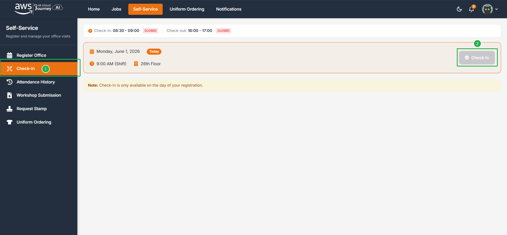
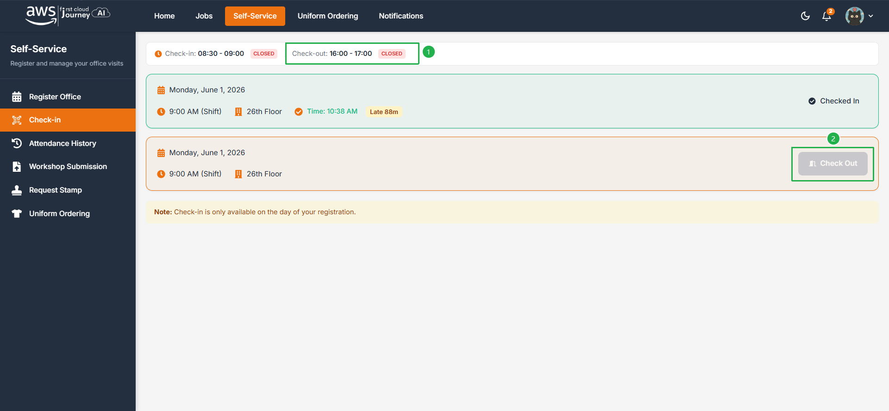
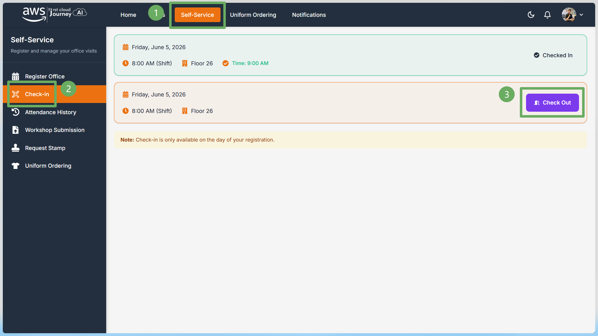
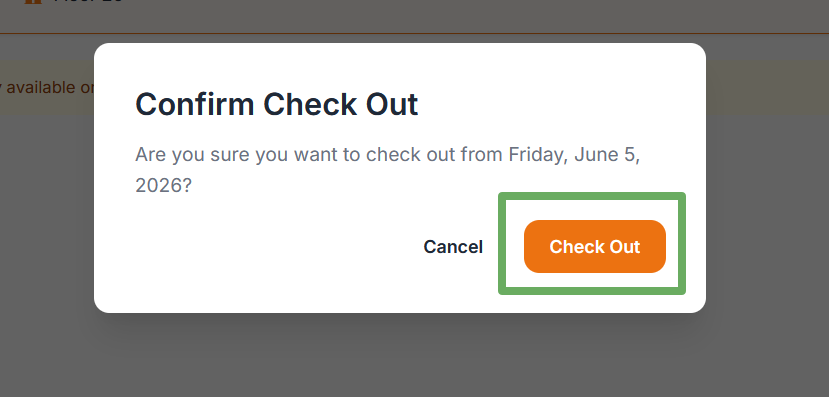
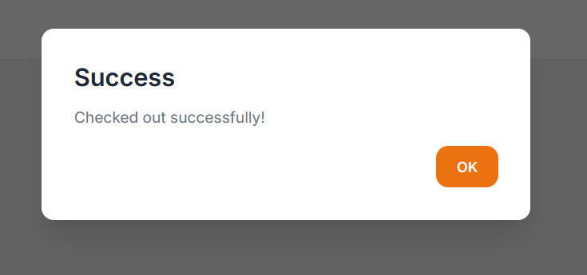
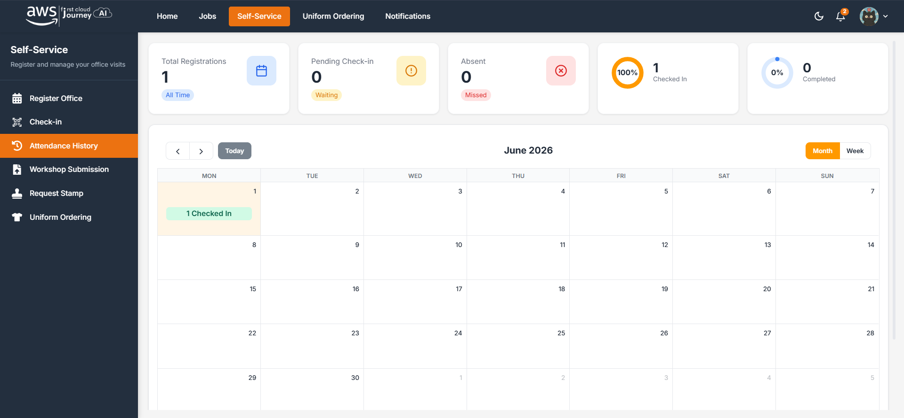

Sinh viên điểm danh **2 lần mỗi ngày**: check-in khi vào phòng học và check-out trước khi ra về. Cả hai đều bấm **thủ công trên portal**. Thiếu một trong hai lần, buổi đó không được tính.

## Khung giờ

| Bước                                  | Thời gian         | Thực hiện ở đâu |
| ------------------------------------- | ----------------- | --------------- |
| Đến văn phòng, check-in với bảo vệ    | **08:30 – 09:00** | Tầng 26         |
| Check-in thủ công trên portal         | **09:00 – 10:00** | Portal          |
| Check-out thủ công trên portal        | **16:00 – 17:00** | Portal          |
| Thu dọn đồ, trả thẻ cho bảo vệ, ra về | **Đúng 17:00**    | Tầng 26         |

:::danger
- Sinh viên **không được** đến trước 08:30. Đợi dưới tòa nhà Bitexco đến đúng giờ.
- Check-in với bảo vệ **sau 09:30** bị tính **vắng** và trừ 0.5 điểm mục Chuyên cần.
- Thu dọn đồ trước 17:00 là vi phạm nội quy học tập.

Chi tiết xem [Quy định về thời gian](/regulations/time).
:::

## Check-in

<Steps>
  <Step title="Check-in với bảo vệ">
    Sinh viên check-in với bảo vệ ở tầng 26 trong khoảng **08:30 - 09:00** và nhận thẻ vào văn phòng. Check-in sau thời gian này sẽ bị coi là đi trễ.
  </Step>
  <Step title="Mở trang Check-in trên portal">
    Vào phòng học, mở portal. Truy cập trang **Check-in** để xem trạng thái. Nếu chưa **Check-in**, nút sẽ hiện màu xám.

    
  </Step>
  <Step title="Bấm Check-in">
    Bấm **Check-in** thủ công trong khoảng **09:00 – 10:00**. Sau khi **Check-in**, nút sẽ sáng màu.

    
  </Step>
</Steps>

## Check-out

<Steps>
  <Step title="Mở trang Check-in">
    Đến **16h** cùng ngày, truy cập **Self-Service** trên portal. Chọn mục **Check-in** ở thanh menu bên trái.

    
  </Step>
  <Step title="Chọn dòng cần check-out">
    Tại danh sách lịch đăng ký trong ngày, tìm dòng đã **Checked In** và bấm **Check Out**.

    
  </Step>
  <Step title="Xác nhận">
    Một hộp thoại xác nhận sẽ hiển thị. Kiểm tra lại ngày cần check-out, sau đó bấm **Check Out** để xác nhận.

    
  </Step>
  <Step title="Kiểm tra kết quả">
    Khi thao tác thành công, hệ thống sẽ hiển thị thông báo **Success**.

    
  </Step>
</Steps>

## Lưu ý

- Chỉ thực hiện check-out sau khi đã check-in đúng ngày đăng ký.
- Sau khi hoàn tất, các bạn có thể kiểm tra lại trạng thái trong **Attendance History**.
- Check-out sau 17h sẽ được xem là vắng mặt.
- Khi check-out không thành công, vui lòng liên hệ ngay với các anh chị admin.

## Lịch sử đăng ký

Truy cập trang **Attendance history** để xem lịch sử đăng ký lên văn phòng.

