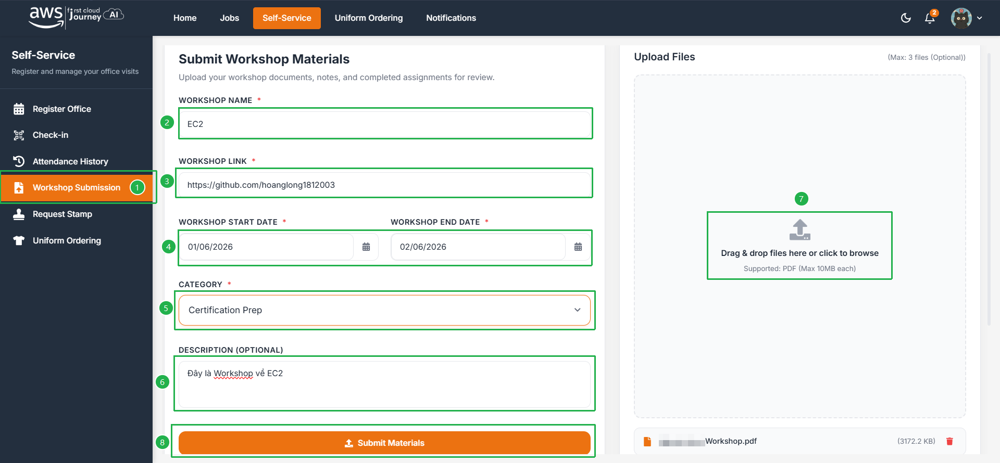
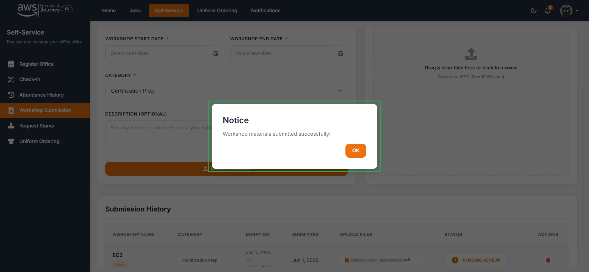
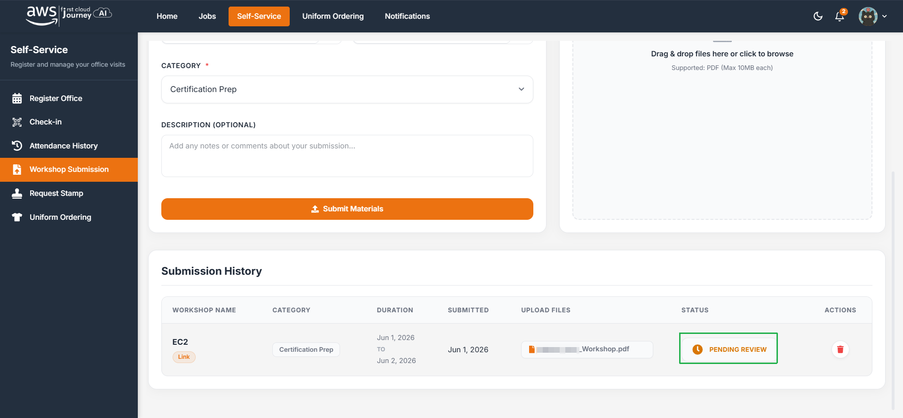

Sinh viên nộp Workshop trên trang **Workshop Submission** của portal. Quy định về nội dung Workshop xem tại [Project](/project).

## Các bước nộp

<Steps>
  <Step title="Mở trang nộp">
    Truy cập trang **Workshop Submission** để nộp Workshop. Điền đầy đủ các thông tin cần thiết.

    :::warning
    Workshop link **không phải** là link source code. Đó là nơi các bạn host workshop của mình (trên GitHub Pages hoặc Vercel,...). Chi tiết xem tại [Project](/project).
    :::

    
  </Step>
  <Step title="Xác nhận nộp thành công">
    Nộp thành công sẽ hiển thị thông báo. Nhấn **OK**.

    
  </Step>
  <Step title="Theo dõi lịch sử nộp">
    Bạn có thể xem lịch sử nộp workshop ở bên dưới. Workshop nộp xong sẽ hiển thị trạng thái **Pending review**.

    
  </Step>
</Steps>

## Các trạng thái đánh giá

| Trạng thái       | Ý nghĩa                                                                                            |
| ---------------- | -------------------------------------------------------------------------------------------------- |
| `Pending review` | Bài nộp đang chờ chấm.                                                                             |
| `Approved`       | Bài nộp đã đạt yêu cầu (đã chấm).                                                                  |
| `Reject`         | Bài nộp chưa đạt. Xem kỹ feedback từ team admin để chỉnh sửa và cập nhật lại bài nộp.             |

:::info
Hãy luôn chủ động kiểm tra trạng thái bài nộp để cập nhật thông tin kịp thời.
:::
