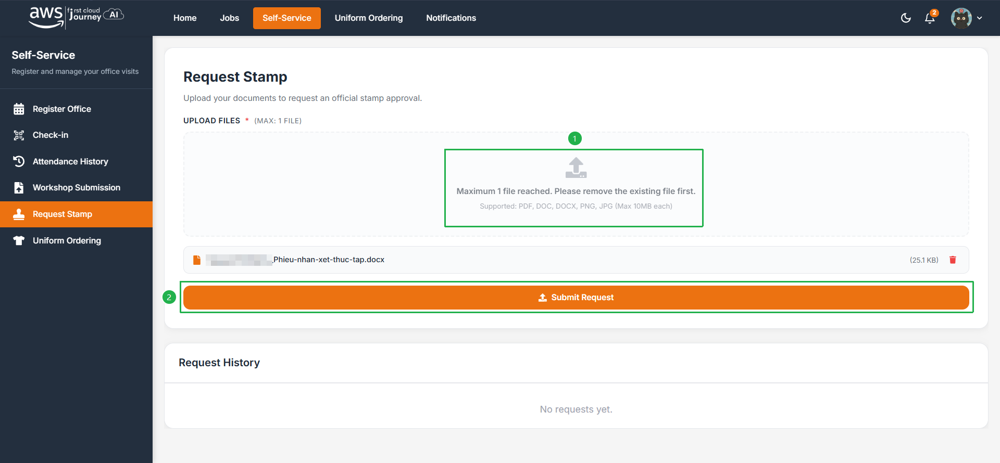
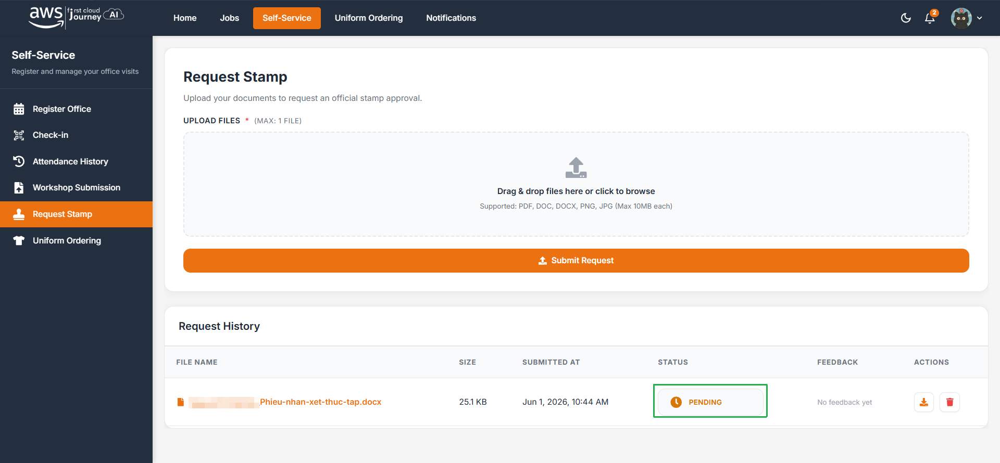

Sinh viên đang trong kỳ thực tập và cần mộc phải đáp ứng trước các điều kiện chương trình đưa ra. Xem chi tiết tại [Yêu cầu Workshop](/project/requirement) và [Xử lý vi phạm](/violations).

## Các bước yêu cầu mộc

<Steps>
  <Step title="Tải giấy tờ lên">
    Ấn **Upload file** để tải lên các giấy tờ liên quan mà nhà trường yêu cầu đối với sinh viên trong kỳ thực tập.
  </Step>
  <Step title="Gửi yêu cầu">
    Ấn **Submit Request** để hoàn tất.

    
  </Step>
  <Step title="Theo dõi trạng thái">
    Sau khi nộp, bạn có thể xem lại lịch sử đã nộp kèm trạng thái. Hãy thường xuyên kiểm tra trạng thái.

    
  </Step>
</Steps>

## Các trạng thái

| Trạng thái | Sinh viên cần làm                                                           |
| ---------- | --------------------------------------------------------------------------- |
| `Approved` | In các file ra và đem lên văn phòng nộp.                                    |
| `Reject`   | Chỉnh sửa file theo feedback.                                               |
| `Stamped`  | Giấy tờ đã được đóng mộc thực tập. Lên văn phòng nhận.                      |
