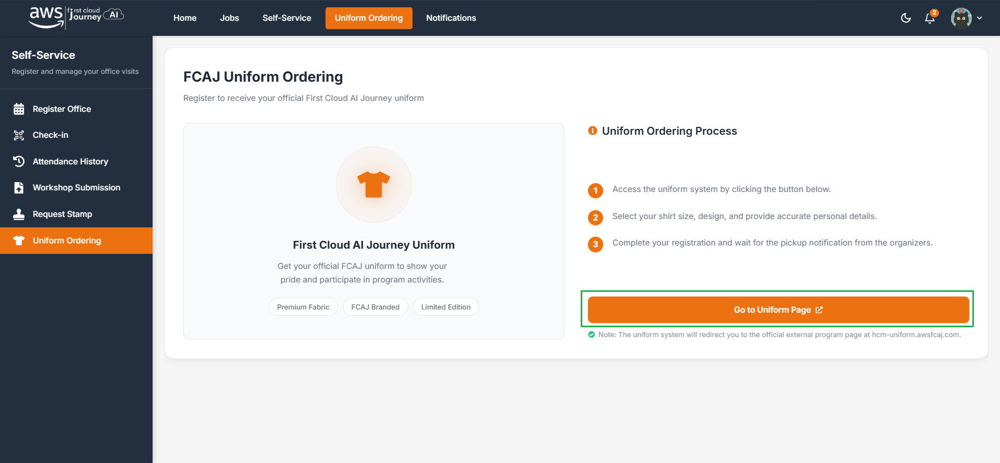
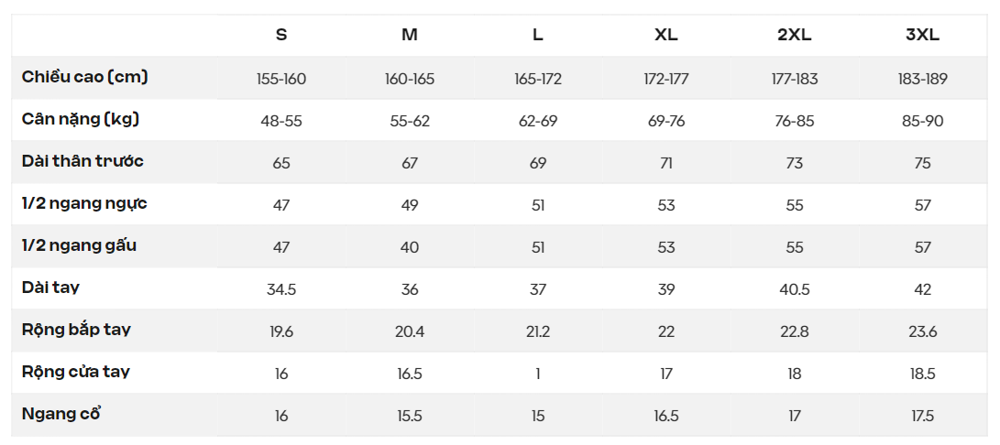
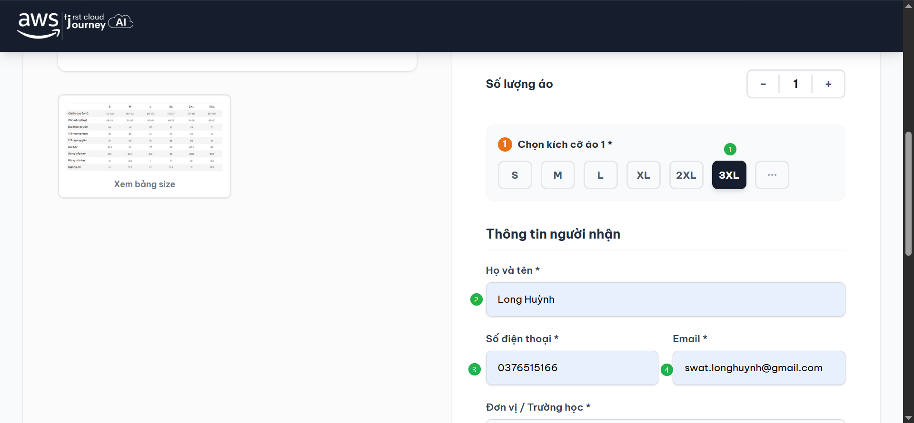
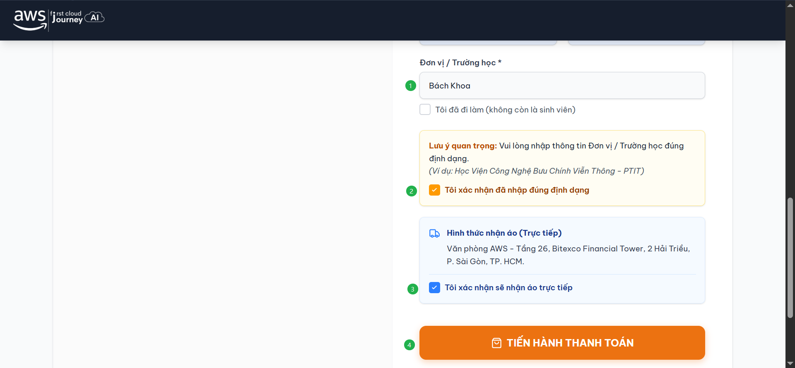
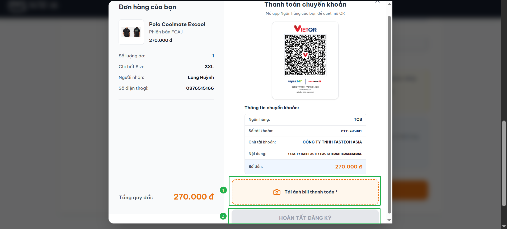

Việc đăng ký đồng phục là **không bắt buộc**. Quy định trang phục xem tại [Trang phục & Tác phong](/regulations/dress-code).

## Các bước đặt áo

<Steps>
  <Step title="Mở trang đặt áo">
    Chọn **Uniform Ordering** và **Go to Uniform Page** để tới trang đặt áo.

    
  </Step>
  <Step title="Nhập thông tin và chọn size">
    Tại trang đăng ký áo, nhập đầy đủ và chính xác các thông tin. Tham khảo **bảng quy chuẩn chọn size áo Polo FCAJ** bên dưới để chọn kích cỡ phù hợp.

    

    

    
  </Step>
  <Step title="Chuyển khoản và hoàn tất">
    Sau khi nhập thông tin, tiến hành chuyển khoản và tải lên hình ảnh đã chuyển khoản. Chọn **Hoàn tất đăng ký**.

    
  </Step>
</Steps>
