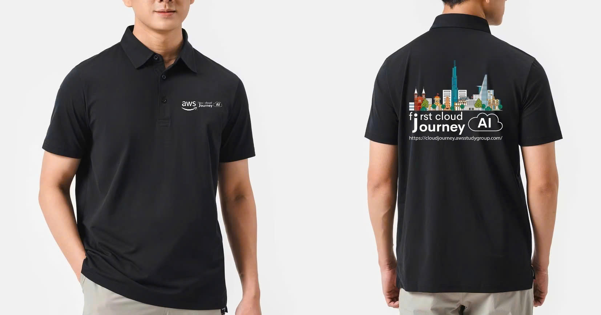
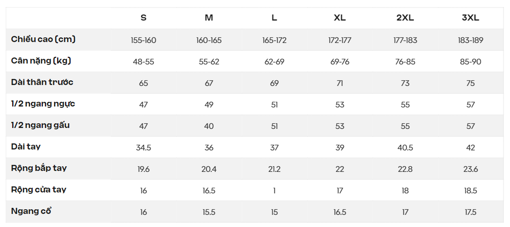

Chuẩn mực về **trang phục** và **tác phong làm việc** khi có mặt tại văn phòng. Vi phạm nhóm quy định này ảnh hưởng trực tiếp đến **điểm tác phong**.

<Callout type="info" title="Cần nhớ" icon="lightbulb" color="#DA70D6">
- Bắt buộc mặc **quần dài** và mang **giày kín mũi, kín gót**.
- **Nghiêm cấm mang dép** gồm dép lê, dép kẹp, sandal hở mũi/hở gót và crocs.
- **Nghiêm cấm** chơi game, lướt mạng xã hội không liên quan công việc hoặc tải game gây nhiễu mạng trong giờ làm việc.
</Callout>

## Trang phục

### Trang phục bắt buộc

- **Bắt buộc mặc quần dài** (không quần short, quần thể thao, váy ngắn).
- **Bắt buộc mang giày kín mũi và gót.**
- Trang phục **gọn gàng, chỉnh chu**, phù hợp môi trường làm việc chuyên nghiệp.

### Áo đồng phục FCAJ

- Khuyến khích mặc **áo đồng phục FCAJ** khi đến văn phòng (nếu đã có) để tạo môi trường chuyên nghiệp, đồng bộ và thuận tiện nhận diện khi ra vào tòa nhà/văn phòng.
- Đăng ký mua áo đồng phục được thực hiện trực tiếp trên Portal. Chi tiết xem tại [Đặt đồng phục FCAJ](/instructions/uniform).

- Tham khảo **bảng quy chuẩn chọn size áo Polo FCAJ**:

### Trường hợp chưa có áo đồng phục

- Mặc áo đen lịch sự, nhã nhặn.
- **Đeo thẻ sinh viên** trong suốt quá trình học tập và làm việc tại văn phòng.

Vi phạm quy định trang phục bị **trừ 0.2 điểm/lần** ở mục Tác phong. Xem [Xử lý vi phạm](/violations).

## Tác phong làm việc

- Giữ không gian làm việc **sạch sẽ, gọn gàng**.
- Không nói chuyện riêng gây ồn ào, ảnh hưởng người khác.
- **Không** dùng thiết bị công ty vào mục đích cá nhân. (Nếu có)
- **Tôn trọng** không gian làm việc chung và đồng nghiệp xung quanh.

**Nghiêm cấm trong giờ làm việc:**

- Chơi game.
- Lướt TikTok / mạng xã hội không liên quan công việc.
- Nói xấu bạn bè, đồng nghiệp.
- Dùng điện thoại cá nhân quá nhiều, không phục vụ công việc.
- Nghe nhạc âm lượng lớn mà không dùng tai nghe.
- Tải game gây nhiễu mạng, mất kết nối.

### Không tải game gây nhiễu mạng [#tai-game]

- Sinh viên **không được** tải game trong giờ làm việc vì làm nhiễu mạng, gây mất kết nối của người khác.
- Sinh viên cố tình tải game sẽ bị **truy IP**, **hủy buổi học** đó và **bị trừ điểm**.

Vi phạm trang phục hoặc tác phong đều bị **trừ điểm phần tác phong**. Mức trừ chi tiết xem [Xử lý vi phạm](/violations).

## Tổng hợp quy định

| Quy định                                  | Mức độ                                      | Hậu quả                                             |
| ----------------------------------------- | ------------------------------------------- | --------------------------------------------------- |
| Mặc quần dài                              | <Badge variant="warning">Bắt buộc</Badge>  | Vi phạm bị trừ **0.2 điểm/lần** mục Tác phong       |
| Mang giày kín mũi và gót                  | <Badge variant="warning">Bắt buộc</Badge>  | Vi phạm bị trừ **0.2 điểm/lần** mục Tác phong       |
| Mang dép                                   | <Badge variant="danger">Nghiêm cấm</Badge> | Vi phạm quy định trang phục và bị trừ điểm          |
| Mặc áo đồng phục FCAJ                    | <Badge variant="success">Khuyến khích</Badge> | Tạo nhận diện thuận tiện, không bắt buộc          |
| Chơi game, lướt mạng xã hội trong giờ làm | <Badge variant="danger">Nghiêm cấm</Badge> | Bị trừ điểm phần Tác phong                          |
| Cố tình tải game gây nhiễu mạng           | <Badge variant="danger">Nghiêm cấm</Badge> | Truy IP, hủy buổi học và bị trừ điểm                 |
